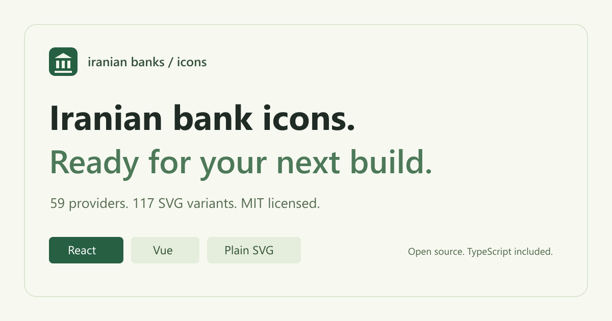

# Iranian Banks Icons

[](https://github.com/houtanrocky/iranian-banks-react-icons/actions/workflows/ci.yml)
[](https://www.npmjs.com/package/@iran-utils/iranian-banks-react-icons)
[](https://www.npmjs.com/package/@iran-utils/iranian-banks-vue-icons)
[](https://www.npmjs.com/package/@iran-utils/iranian-banks-icons-core)
[](LICENSE)

**SVG icons for Iranian banks and payment providers, for React, Vue 3, and any web framework.** Browse 59 providers and 117 variants: 59 color logos and 58 monochrome logos. SnappPay is color-only.

**[Browse the icon library and live examples →](https://houtanrocky.github.io/iranian-banks-react-icons/)**

[](https://houtanrocky.github.io/iranian-banks-react-icons/)

- Named exports with tree shaking in ESM builds.
- TypeScript declarations, CommonJS builds, React refs, and Vue SVG attributes.
- Scalable SVGs with preserved viewBoxes and color or monochrome variants.
- English and Persian search in the live icon browser.
- Includes historical and merged institutions for existing integrations.

## Choose your package

| Framework | Package | Install |
| --- | --- | --- |
| React 16.13.1, 17, 18, 19 | [@iran-utils/iranian-banks-react-icons](packages/react) | `npm i @iran-utils/iranian-banks-react-icons` |
| Vue 3 | [@iran-utils/iranian-banks-vue-icons](packages/vue) | `npm i @iran-utils/iranian-banks-vue-icons` |
| Angular, Svelte, Web Components, plain JavaScript | [@iran-utils/iranian-banks-icons-core](packages/core) | `npm i @iran-utils/iranian-banks-icons-core` |

## React

```tsx
import { MellatColorIcon, MellatIcon } from '@iran-utils/iranian-banks-react-icons';

export function PaymentMethod() {
  return (
    <div>
      <MellatColorIcon width={48} height={48} role="img" aria-label="Bank Mellat" />
      <MellatIcon width={48} height={48} fill="currentColor" aria-hidden="true" />
    </div>
  );
}
```

Components accept `React.SVGProps<SVGSVGElement>` and forward refs to the SVG element. Set `width` and `height` explicitly; no default size is imposed. The artwork is fixed, so React `children` and `dangerouslySetInnerHTML` do not replace it.

## Vue 3

```vue
<script setup>
import { MellatColorIcon, MellatIcon } from '@iran-utils/iranian-banks-vue-icons';
</script>

<template>
  <MellatColorIcon :width="48" :height="48" role="img" aria-label="Bank Mellat" />
  <MellatIcon :width="48" :height="48" fill="#146c4a" aria-hidden="true" />
</template>
```

Vue components forward attributes, classes, styles, and event handlers to their root `<svg>`. Slots do not replace the artwork.

## Plain SVG data

```js
import { MellatColorIcon } from '@iran-utils/iranian-banks-icons-core';

// Framework-independent, trusted package data.
const { viewBox, content } = MellatColorIcon;
const svg = `<svg xmlns="http://www.w3.org/2000/svg"
  xmlns:xlink="http://www.w3.org/1999/xlink"
  viewBox="${viewBox}" width="48" height="48" role="img" aria-label="Bank Mellat">
  ${content}
</svg>`;
```

Core exports have the existing `{ viewBox: string, content: string }` contract. When rendering strings, only inject trusted SVG data. Include the `xmlns:xlink` namespace when serializing icons with linked definitions as standalone SVG documents.

## Color, sizing, and accessibility

| Attribute | Behavior |
| --- | --- |
| `width`, `height` | Explicit dimensions such as `48`, `2em`, or `100%` |
| `fill` | Tint monochrome exports such as `MellatIcon`; use `currentColor` to inherit text color |
| `className` (React), `class` (Vue), `style` | Standard SVG styling |
| `role="img"`, `aria-label` | Name meaningful logos for assistive technology |
| `aria-hidden="true"` | Hide decorative logos from assistive technology |
| `ref` (React), event handlers | Access the SVG node and handle interaction |

Color exports preserve their artwork palette. Some monochrome artwork retains white cutouts. `MaskanIcon` is a white reverse logo intended for dark backgrounds; its white fill is preserved. IDs are prefixed per source file so different inline logos do not share gradients; repeated instances of the same icon share identical definition IDs. Avoid selecting internal IDs in CSS.

## Available icons

Use the [searchable icon catalog](https://houtanrocky.github.io/iranian-banks-react-icons/#icons) to preview logos and copy imports for your framework. Every provider below exports `[Name]ColorIcon` and `[Name]Icon`, except SnappPay.

| Group | Providers |
| --- | --- |
| Banks (38) | Melli, Mellat, Saderat, Tejarat, Sepah, Keshavarzi, Maskan, Refah, Post, SanatMadan, TaavonEslami, Pasargad, Saman, Parsian, Ayandeh, Karafarin, EghtesadNovin, Sina, Shahr, Gardeshgari, KhavarMianeh, Dey, Caspian, Sarmayeh, Resalat, IranZamin, IranEurope, IranVenezuela, Noor, MehrIran, Melall, Tosee, ToseeSaderat, ToseeTaavon, StandardChartered, BluBank, Bankino, Futurebank |
| Payment platforms (11) | Zarrinpal, PayIr, Payping, NextPay, Idpay, Vandar, Digipay, Zibal, Hesabit, AsanPardakht, SnappPay (color only) |
| PSPs (3) | SamanKish, PasargadPep, Sadad |
| Networks (2) | Shaparak, BankMarkazi |
| Merged institutions (5) | SepahMergedAnsar, SepahMergedGhavamin, SepahMergedHekmat, SepahMergedKosar, SepahMergedMehrEghtesad |

Names are identifiers for included artwork, not a current registry of licensed institutions.

## Bundle size and image optimization

Prefer named ESM imports so bundlers can omit unused icons. A namespace import used dynamically, or a CommonJS import, can retain the entire library. Detailed artwork such as Melli and Sepah is larger than a simple mark; check the icons you actually ship.

The [reproducible SVG audit](reports/image-optimization.md) lists the largest files, gzip sizes, fixes for gradient collisions and monochrome tinting, and visual comparisons against every source SVG. Run `pnpm audit:images` after a build to regenerate it.

## Development and verification

Requires Node.js 22.12+ and pnpm 10.13.1. Use `corepack enable` if pnpm is not installed.

```sh
pnpm install --frozen-lockfile
pnpm build
pnpm docs:dev
```

```sh
pnpm test                   # Build, unit/DOM/SSR, types, SVG rendering, packed consumers
pnpm docs:build             # Static, prerendered GitHub Pages site
pnpm exec playwright install chromium
pnpm test:e2e               # Desktop/mobile interactions, SEO, accessibility
# or run everything:
pnpm test:all
```

The suite checks all 117 exports, React and Vue server rendering, SVG props, events and refs, English/Persian search, SVG ID references, visual similarity at 96/256 px, real tarball installs, CommonJS and native ESM, TypeScript contracts, and tree shaking. CI also installs consumers with React 16–19 and checks Vue 3.0 and current Vue 3.

```text
raw/                  Original artwork (preserved)
scripts/lib/          Shared catalog validation and package generation
packages/core/        Framework-independent SVG data
packages/react/       React components
packages/vue/         Vue 3 components
apps/docs/            Prerendered showcase and searchable gallery
reports/              Image audit and discoverability notes
```

GitHub Pages deployment builds the site after successful tests on `main`, then publishes `apps/docs/dist` with the official Pages artifact and deployment actions. See the [visibility and publishing guide](reports/visibility.md) for repository metadata, social previews, sitemap submission, and release notes.

## Contributing

See [CONTRIBUTING.md](CONTRIBUTING.md). [Report a bug](https://github.com/houtanrocky/iranian-banks-react-icons/issues/new?template=bug-report.yml), [request an icon](https://github.com/houtanrocky/iranian-banks-react-icons/issues/new?template=icon-request.yml), or improve the documentation. Add source SVGs to `raw/` and keep existing export names stable.

## فارسی

کتابخانهٔ آیکون بانک‌ها و سرویس‌های پرداخت ایرانی برای React، Vue و SVG مستقل از فریم‌ورک. شامل ۵۹ ارائه‌دهنده و ۱۱۷ آیکون رنگی و تک‌رنگ، همراه با تایپ‌های TypeScript و جستجوی فارسی در [فهرست آیکون‌ها](https://houtanrocky.github.io/iranian-banks-react-icons/).

## License

[MIT](LICENSE) © [Houtan Rocky](https://github.com/houtanrocky). Names and logos belong to their respective owners. This community project is not affiliated with or endorsed by those institutions.
